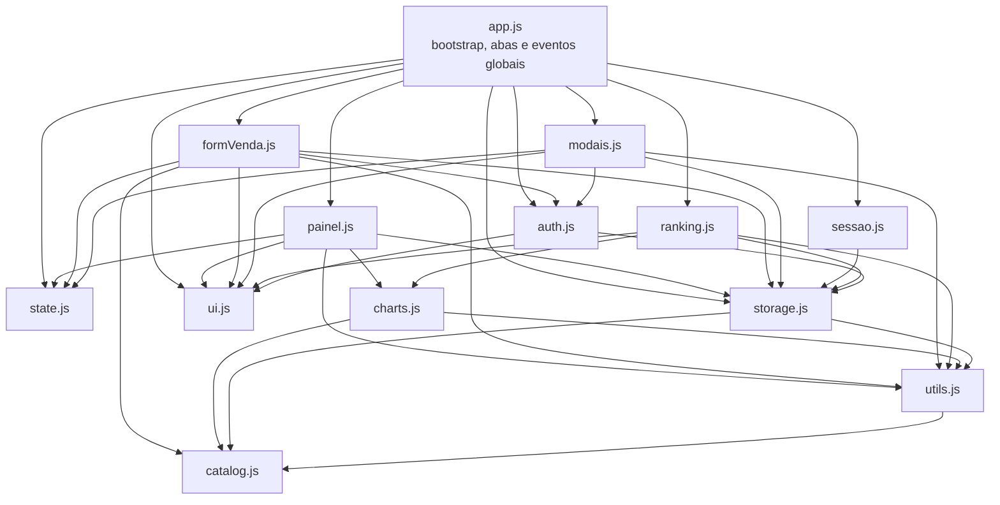

# Contexto do projeto — Ranking de Vendas

Resumo de arquitetura e padrões, para orientar quem for mexer no código.

## Visão geral

SPA estática para registrar vendas de motos por consultor, com ranking geral, painel individual e gráficos de BI. Hospedada no GitHub Pages e sem backend: todos os dados ficam no `localStorage` do navegador.

- **Stack:** HTML5, CSS3 e JavaScript puro em ES Modules. Não há bundler. O `package.json` serve só para as ferramentas de desenvolvimento (`npm test`, `npm run lint`, `npm run format`, `npm run format:check`); o site não tem dependência npm em tempo de execução.
- **Dependência externa:** Chart.js 4.4.1, servido localmente de `vendor/chart.js/chart.umd.js` (cópia fixa do pacote npm) e usado como global `Chart`. O `index.html` carrega esse arquivo antes de `js/app.js`.
- **Execução local:** como usa ES Modules, precisa de um servidor HTTP, por exemplo `npx serve .` ou `python -m http.server`. Abrir pelo `file://` não funciona.
- **Tamanho:** cerca de 7,5 mil linhas (JS ≈ 5,1k, CSS ≈ 1,6k, HTML ≈ 0,9k).

## Módulos e dependências

| Módulo | Responsabilidade | Acessa DOM? |
|---|---|---|
| `catalog.js` | Catálogo fixo de modelos e anos e paletas de cores (`getCorConsistente`) | Não |
| `utils.js` | Funções **puras**: validação (placa, contrato, datas), filtros por período, ranking com empate, matriz e séries para gráficos | Não |
| `storage.js` | Camada de dados no `localStorage`: CRUD, sessão, login com SHA-256, bloqueio de tentativas, permissões, seed e migração de schema | Não (só `localStorage`/`crypto`) |
| `state.js` | Estado compartilhado (`appState`) e referências de elementos do DOM (`DOM`) | Sim (leitura de elementos na carga) |
| `ui.js` | Helpers de UI: toast, erros de campo, controles segmentados, abas acessíveis com hash na URL, `
` recolhíveis | Sim |
| `auth.js` | Modal de login (`<dialog>`), contagem de bloqueio e alternância da UI entre logado e deslogado, com callbacks | Sim |
| `sessao.js` | Monitoramento proativo da expiração de sessão (timer de 8 h e verificação em `visibilitychange`), com callback para a UI | Sim (`document.visibilityState`) |
| `charts.js` | Wrapper do Chart.js: instâncias em `Map`, estados vazio e erro de CDN, tabela acessível e exportação em PNG | Sim |
| `ranking.js` | Aba "Ranking geral": filtros sincronizados com a query string, KPIs, tabela ordenável, matriz, vendas gerais paginadas e BI | Sim |
| `painel.js` | Aba "Painel do consultor": seletor de consultor, filtro de período, KPIs, gráfico individual, tabelas por modelo/ano e histórico | Sim |
| `formVenda.js` | Aba "Nova venda": limites de data, selects dependentes de modelo/ano, validação dos campos e envio de nova venda | Sim |
| `modais.js` | Modais `<dialog>` de confirmação de exclusão de venda e de restauração dos dados de demonstração | Sim |
| `app.js` | Ponto de entrada (`initApp`): bootstrap dos submódulos, roteamento de abas e listeners globais (`hashchange`, `popstate`, `resize`, `storage`) | Sim |

## Modelo de dados (`localStorage`, prefixo `ranking_motos_`)

| Chave | Conteúdo |
|---|---|
| `_schema` | Versão do schema (`SCHEMA_VERSION = 2`) |
| `_consultores` | `[{ id, nome }]` |
| `_usuarios` | `[{ id, usuario, nome, senhaHash, consultorId }]` |
| `_vendas` | `[{ id, consultorId, placa, numeroContrato, modelo, anoModelo, dataVenda (ISO) }]` |
| `_sessao` | `{ usuarioId, expiraEm }`, válida por 8 h |
| `_login_tentativas` | `{ falhas, bloqueadoAte }`: bloqueio de 60 s após 5 falhas |
| `_consultor_ativo_id` | ID do consultor selecionado no painel |

- O seed (`inicializarSeedSeNecessario`) cria 5 consultores, o usuário demo `JoaoVitor`/`123456` e 8 vendas por consultor, das quais 3 caem obrigatoriamente em hoje ou na semana atual.
- A migração para a v2 garante que o consultor e o usuário demo existam sem apagar os dados atuais.
- Placa e contrato são únicos: o contrato é comparado sem diferenciar maiúsculas, e a placa é normalizada sem hífen, em maiúsculas.

## Regras de negócio

- Só quem está logado cadastra vendas, e cada usuário exclui apenas as próprias vendas (checagem em `addVenda` e `deleteVenda`).
- A placa segue o padrão Mercosul (`ABC1D23`) ou o antigo (`ABC1234` ou `ABC-1234`).
- O contrato aceita só letras e números.
- O modelo e o ano precisam constar em `MOTOS_CATALOG`, e o ano tem de ser válido para aquele modelo.
- A data da venda vai de 01/01/2023 (`DATA_MINIMA_VENDA`) até hoje e não pode estar no futuro.
- Os períodos são `dia`, `semana` (de segunda a domingo) e `mes`, sempre no fuso local.
- Os filtros do ranking ficam na URL (`?periodo=&modelo=&ano=&grafico=&dim=`), e valores inválidos voltam ao padrão. A aba ativa fica no hash (`#ranking`, `#painel`, `#nova-venda`).
- **Segurança:** a autenticação é só demonstrativa e pode ser contornada pelo DevTools, como avisa o cabeçalho de `storage.js`. Não tratar como segurança real.

## Convenções de código

- **Idioma:** identificadores, comentários e mensagens em **português** (`camelCase`, por exemplo `gerarRanking`, `renderKPIsPainel`). Constantes em `UPPER_SNAKE_CASE`.
- **Prefixos de função:** `render*` desenha DOM, `get*`/`obter*` lê, `validar*`/`normalizar*` são puras, `handle*` trata eventos, `init*`/`setup*` inicializam e `popularSelect*` preenche selects.
- **Estado:** um objeto de estado por módulo de tela (`appState`, `rankingState`) e um cache de elementos `DOM` em `app.js`. Não há framework reativo: cada mudança chama um `render*` explícito.
- **XSS:** não se usa `innerHTML` em nenhum lugar. O DOM é montado com `createElement` e `textContent`. **Manter essa regra.**
- **Erros:** `storage.js` lança `Error` com mensagem pronta para o usuário, e a UI captura e mostra com `showToast(msg, 'error')` ou `exibirErroCampo`.
- **Acessibilidade:** `role="tablist/tab/tabpanel"`, `aria-pressed`, `aria-invalid`, `<dialog>` nativo, uma tabela de dados alternativa para cada gráfico e respeito a `prefers-reduced-motion`.
- **Estilo:** imposto pelo Prettier (`.prettierrc.json`: 2 espaços, aspas simples, ponto e vírgula, sem vírgula no final, 100 colunas) e pelo ESLint (`eslint.config.js`: recommended, `eqeqeq`, `no-var`, `no-unused-vars`). Rode `npm run format` e `npm run lint` antes de commitar. Funções com data aceitam um parâmetro `dataReferencia`/`dataRef = new Date()` para facilitar testes.
- **CSS:** design tokens em `:root` (`--primary`, `--bg-*`, `--text-*`, `--radius-*`), responsivo com breakpoint principal em 600 px e tabelas que viram cards no celular (`table-responsive-cards`).
- Comentários citam itens de especificação ("Item 1.1", "Item C5" etc.), herdados de rodadas anteriores de requisitos.

## Estado atual (29/10/2026)

As funcionalidades do README estão implementadas e o site está publicado no GitHub Pages. O código é cuidadoso em validação, acessibilidade e prevenção de XSS. A estrutura de engenharia, porém, está ausente:

| Item | Situação |
|---|---|
| Controle de versão | Git ligado a `origin` = `github.com/johnathadev/ranking-vendas`, branch principal `main` |
| Testes automatizados | `node --test` em `tests/` (42 testes: `utils.js` e `storage.js`) |
| Lint / formatter | ESLint 9 (flat config) e Prettier 3; formatação em massa registrada em `.git-blame-ignore-revs` |
| `package.json` | Só dependências de desenvolvimento (`eslint`, `@eslint/js`, `globals`, `prettier`) e os scripts |
| CI | Ausente |
| Documentação | README bom; este arquivo |
| TODO/FIXME no código | Nenhum |

## Problemas identificados

Severidade: **A** = bug ou risco funcional, **M** = qualidade ou manutenção, **B** = melhoria.

| # | Sev. | Problema | Onde |
|---|---|---|---|
| P1 | — | ~~Placa duplicada é aceita.~~ **Decisão do dono (29/10/2026): a mesma placa pode aparecer em vários contratos.** Não é bug. `isPlacaExistente` fica sem uso e será removida como código morto, junto com P5. A unicidade vale só para o **contrato**. | `storage.js:458` |
| P2 | A | **Sem rede de testes** para regras críticas (períodos, ranking com empate, validações, permissões). Qualquer refatoração é às cegas. | — |
| P3 | M | **Sessão expira sem a UI perceber.** A expiração de 8 h só é verificada quando alguma ação chama `getSessaoAtiva()`; a tela continua mostrando "logado" e o formulário até a próxima interação. | `storage.js:331`, `auth.js` |
| P4 | M | **PNG exportado com fundo transparente:** não há plugin que pinte o fundo do canvas, então em visualizadores com tema escuro o gráfico fica ilegível. *Provável, precisa ser confirmado no navegador.* | `charts.js:187` |
| P5 | M | **Código morto:** `addConsultor` não é usada em lugar nenhum. | `storage.js:189` |
| P6 | M | **Handler de exclusão registrado duas vezes** (`click` do botão e `submit` do form). Hoje funciona porque o `preventDefault` do clique cancela o submit, mas a ligação é frágil. | `app.js:969-974` |
| P7 | M | ~~**Arquivos grandes:** `app.js` (≈1k linhas) mistura bootstrap, painel, formulário e modais; `ranking.js` (≈930) e `charts.js` (≈850) também são grandes.~~ **Resolvido para `app.js` na tarefa 7:** dividido em `state.js`, `sessao.js`, `formVenda.js`, `modais.js`, `painel.js` e `app.js` (≈206 linhas). | `js/` |
| P8 | M | ~~**Efeito colateral em leitura:** `getSessaoAtiva()` chama `logout()` (escreve no storage), o que pode disparar eventos `storage` em outras abas durante um render. `getEstadoBloqueioLogin()` faz o mesmo ao limpar as tentativas.~~ **Resolvido na tarefa 7:** leituras puras e funções explícitas `limparSessaoInvalida()` e `limparTentativasVencidas()`. | `storage.js` |
| P9 | — | ~~**Chart.js por CDN sem `integrity` (SRI)** e sem fallback local. Há uma mensagem de erro, mas sem gráfico.~~ **Resolvido no passo 8:** cópia local em `vendor/chart.js/`. | `index.html:877` |
| P10 | — | ~~Dispersão no filtro "dia" cai numa única coluna.~~ **Não é bug (revisado em 29/10/2026):** `pontosDispersao` devolve o dia do mês em `x`, mas `charts.js` (cerca da linha 499) transforma o gráfico numa linha do tempo no filtro "dia" (x = horário, y = item da dimensão). | `charts.js:499` |
| P12 | B | `combinarDataComHoraAtual` lança `TypeError` se `dataYMD` não for string; as demais funções de `utils.js` tratam tipos inválidos sem lançar erro. Hoje só é chamada com valor já validado. | `utils.js:90` |
| P13 | B | `formatarPlaca` formata qualquer texto de 7 caracteres alfanuméricos (por exemplo `1234567` → `123-4567`) sem verificar se é placa válida. As placas gravadas já são validadas, então o impacto é baixo. | `utils.js:27` |
| P14 | B | `addVenda` grava `numeroContrato` com as letras como foram digitadas (`trim()`), embora a unicidade seja verificada em maiúsculas. Assim, a mesma lista pode ter `ct123` e `CT124`. | `storage.js:509` |
| P15 | B | A migração v2 só gera vendas de demonstração para João Vitor se o consultor foi criado agora; se ele já existia sem vendas, fica com 0. | `storage.js:829` |
| P16 | B | `resetarDadosDemonstracao` sempre recria a sessão como JoaoVitor, mesmo que outro usuário a tenha chamado (hoje só existe esse usuário), e não limpa as tentativas de login. | `storage.js:882` |
| P11 | B | **Login é só demonstrativo**: hash e bloqueio no cliente podem ser contornados. Já está documentado; só seria resolvido com um backend. | `storage.js` |

## Plano de próximos passos (priorizado)

| Ordem | Tarefa | Resolve | Depende de |
|---|---|---|---|
| 0 | ✓ Feito: pasta ligada a `github.com/johnathadev/ranking-vendas` (`main` em `1a74d9a`) | Pré-requisito do fluxo | — |
| 1 | ✓ Feito (branch `feat/testes-utils`, 27 testes): base de testes e cobertura de `utils.js` | P2 | 0 |
| 2 | ✓ Feito (branch `feat/testes-storage`, 41 testes no total): login, bloqueio, sessão, permissões, seed, migração e reset | P2 | 1 |
| 3 | ✓ Feito dentro da tarefa 2: teste da placa repetida aceita e do contrato duplicado rejeitado | P1 | 2 |
| 4 | ✓ Feito (branch `chore/lint-prettier`): ESLint e Prettier, lint com 0 problemas | Padronização | 1 |
| 5 | ✓ Feito (branch `fix/correcoes-pequenas`, 42 testes). Pequenas correções: expiração de sessão refletida na UI, fundo branco no PNG, remover `addConsultor` e `isPlacaExistente`, unificar o handler de exclusão, tornar `combinarDataComHoraAtual` e `formatarPlaca` defensivas, gravar o contrato normalizado | P3–P6, P12–P14 | 2 |
| 6 | ✓ Feito (branch `chore/ci`): `.github/workflows/ci.yml` (lint, format:check, test) e badge no README. Só roda depois do push | Garantia contínua | 0, 1, 4 |
| 6b | ✓ Feito na tarefa 7: seção "Estrutura" do README atualizada | Documentação | 6 |
| 7 | ✓ Feito (branch `refactor/app-modulos`, 43 testes): `app.js` dividido em `state.js`, `sessao.js`, `formVenda.js`, `modais.js` e `painel.js`; leituras de sessão e bloqueio sem escrita | P7, P8 | 2, 6 |
| 8 | ✓ Feito (branch `chore/chartjs-local`): Chart.js 4.4.1 servido de `vendor/chart.js/`, idêntico ao pacote npm (SHA-256 conferido), sem CDN | P9 | — |

## Fluxo de trabalho

- Cada tarefa vai numa branch própria (`feat/...`, `fix/...`, `test/...`, `chore/...`), com commits pequenos e mensagens no imperativo.
- A revisão do Tech Lead lê o `git diff` e roda os testes, e só então responde "Aprovado" ou lista as correções.
- O merge na branch principal só acontece com confirmação do dono do projeto.
